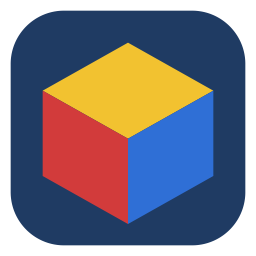
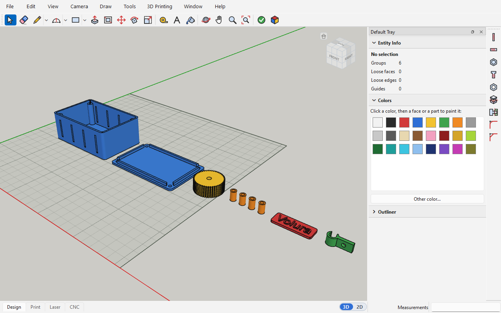
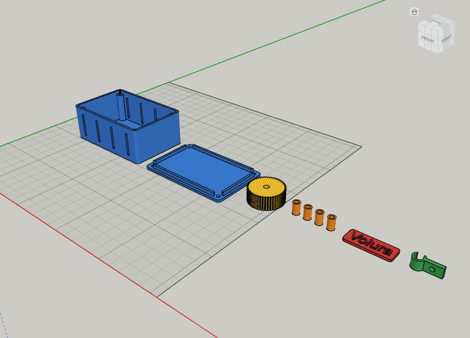
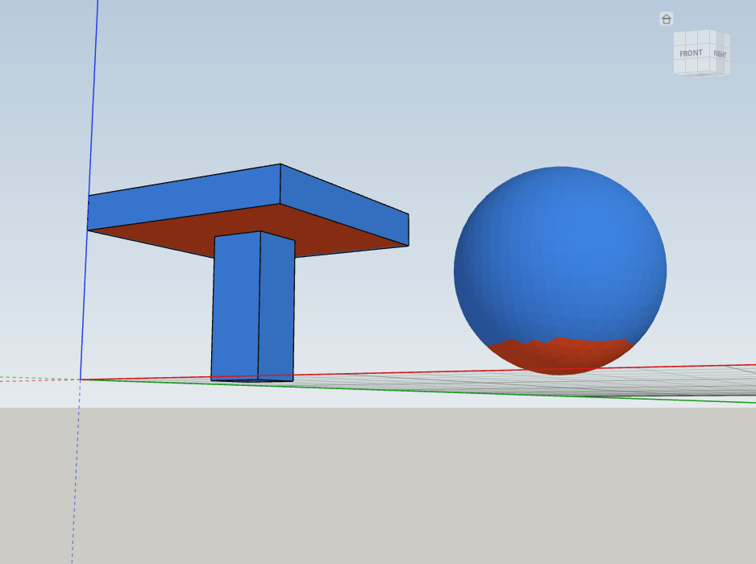
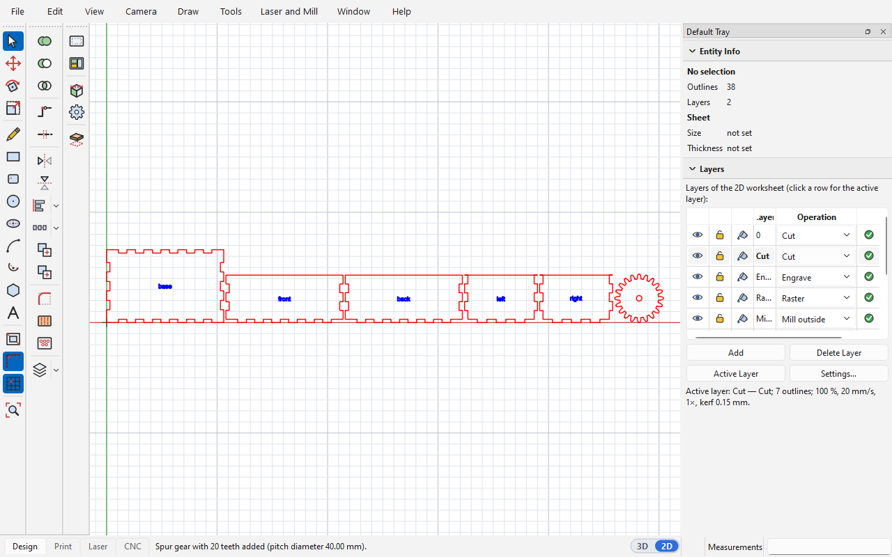
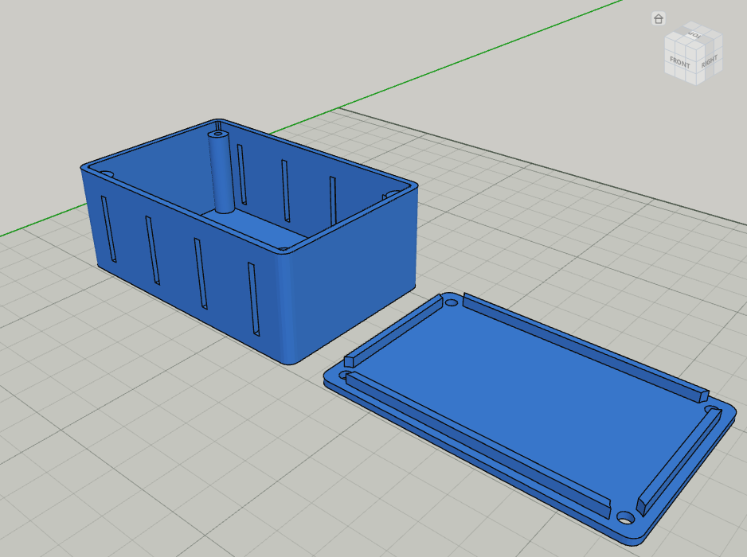

<p align="center">
  
</p>

<h1 align="center">Volura</h1>

<p align="center">
  <b>One program for makers: design it in 3D, then print it, laser it or mill it.</b><br>
  Open source, free, for Windows and Linux.
</p>

<p align="center">
  <a href="https://github.com/Lexvdpoel/Volura/releases/latest"></a>
  <a href="https://github.com/Lexvdpoel/Volura/releases"></a>
  <a href="https://github.com/Lexvdpoel/Volura/actions/workflows/build.yml"></a>
  <a href="LICENSE"></a>
  
  <a href="https://github.com/sponsors/Lexvdpoel"></a>
</p>

<p align="center">
  <a href="https://volura.dev">Website</a> ·
  <a href="https://volura.dev/manual">Manual</a> ·
  <a href="https://github.com/Lexvdpoel/Volura/releases/latest">Download</a> ·
  <a href="CHANGELOG.md">Changelog</a> ·
  <a href="https://github.com/Lexvdpoel/Volura/discussions">Discussions</a> ·
  <a href="https://github.com/sponsors/Lexvdpoel">Sponsor</a>
</p>

<p align="center">
  
</p>

## Why Volura

Most makers juggle a modeller, a slicer, a laser program and a CAM tool, each with its own file
format and its own habits. **Volura brings them together in one program**: you draw a part once,
and the same model goes to the 3D printer, the laser cutter or the CNC mill.

You model the way SketchUp 2017 works: draw a flat face and pull it into a volume with
**Push/Pull**. Edges split each other where they cross, a closed shape becomes a face and the
Eraser merges faces again. Every part is checked to be a closed, printable volume, thanks to
the [Manifold](https://github.com/elalish/manifold) kernel.

The interface is in English and Dutch (*Window > Preferences > General > Language*).

## Highlights

<table>
  <tr>
    <td width="50%" valign="top">
      
      <b>Design</b><br>
      Push/Pull modelling with inference and typed measurements, groups and solid tools,
      screw threads, 3D text and dozens of ready-made parts: project boxes, gears, hinges,
      Gridfinity bins, cable clips and more.
    </td>
    <td width="50%" valign="top">
      
      <b>Print</b><br>
      Print Check shows what hangs over and needs support before you print, multicolour 3MF for
      AMS and MMU printers, and built-in slicing for filament (CuraEngine) and resin
      (UVtools) printers - with every colour of the model on the filament you chose for it.
    </td>
  </tr>
  <tr>
    <td width="50%" valign="top">
      
      <b>Laser and CNC</b><br>
      A 2D worksheet with finger-joint boxes, living hinges, nesting and engraving, G-code
      for GRBL lasers and 2.5D mills, 3D milling of the model, and a controller that drives
      your machine over USB.
    </td>
    <td width="50%" valign="top">
      
      <b>Made for makers</b><br>
      Imports STL, OBJ, 3MF, PLY, glTF, SVG and DXF; repairs broken meshes; exports STL, 3MF,
      OBJ, STEP, SVG, DXF and G-code. Free and open source under the MIT license.
    </td>
  </tr>
</table>

## Download

| Windows | Linux |
| --- | --- |
| [**Volura-windows-setup.exe**](https://github.com/Lexvdpoel/Volura/releases/latest/download/Volura-windows-setup.exe) (installer, no admin rights needed) | [**Volura-linux-x86_64.tar.gz**](https://github.com/Lexvdpoel/Volura/releases/latest/download/Volura-linux-x86_64.tar.gz) |
| or the [portable zip](https://github.com/Lexvdpoel/Volura/releases/latest/download/Volura-windows-x86_64.zip) | see [Linux](#linux) for the install script |

Volura updates itself; see [Installation](#installation) for the details.

## Missing something? Tell us

We want Volura to be the one program a maker needs. If something is missing, does not make
sense or does not work, please [open an issue](https://github.com/Lexvdpoel/Volura/issues/new/choose)
or start a [discussion](https://github.com/Lexvdpoel/Volura/discussions). Every report counts,
and we aim to fix it **within a day**.

## Sponsor Volura

Volura is free and open source, and it stays that way. If it saves you time or money,
please consider [**becoming a sponsor**](https://github.com/sponsors/Lexvdpoel): sponsor our
mission to build more open source software and to keep releasing improvements. Every
sponsorship, large or small, buys time for new parts, fixes and features that every maker
gets for free.

[](https://github.com/sponsors/Lexvdpoel)

## All features

- SketchUp workflow: Line, Rectangle, Circle, Polygon, Arcs (2 Point Arc, Arc, 3 Point Arc and
  Pie), 3D Text, Push/Pull, Offset, Move, Rotate, Scale, Tape Measure, Paint Bucket, Eraser,
  Orbit/Pan/Zoom
- Inference like in SketchUp: endpoint, midpoint, origin, on edge, on face, red/green/blue axis,
  and axis + edge combined. Arrow keys or Shift lock a direction
- Length snapping to 1 mm (adjustable), angles snap to 15°
- Measurements box at the bottom right (just type): `25`, `2,5cm`, `40;20`, `64s`, `10;0;5`, `5x`, `/5`.
  The direction follows your mouse, like in SketchUp
- **Arrays**: after a Ctrl-copy, type `5x` (or `x5`, `5*`) to repeat it into 5 copies and `/5` to
  divide the step into 5. With Move this makes a row, with Rotate a circle (rotate-copy a spoke
  60°, type `5x` for 6 spokes); one undo removes the whole array
- Selecting: click, double-click (face + edges), triple-click (everything connected), selection box
- **Groups** (G): every group is a separate printable part with its own filament color. Double-click
  to edit a group
- **Multicolor**: hold **Alt** while pushing/pulling. Inwards makes an *inlay* (pocket + filling as a
  separate group), outwards a separate part. Ctrl works like in SketchUp (new starting face)
- Solid tools on groups: union, subtract, intersect, trim, split, outer shell, mirror, place on bed
- **Intersect Faces** (Tools or right-click): *With Model* adds the cut lines with the rest of the
  model as edges so faces split, *With Selection* only between the selected items
- Primitives: box, cylinder, cone, sphere, torus
- Display styles under **View**: Wireframe, Hidden Line, Shaded and Monochrome (View > Face Style),
  X-ray (Alt+X), Back Edges (K), Hidden Geometry (softened edges) and hiding the rest of the model
  while editing a group
- **View cube** in the top right corner of every 3D view (View > View Cube): click a face, an edge
  or a corner of the cube to look at the model from there, drag the cube to orbit, and click the
  house to go back to the iso view with the whole model in view. The four arrows beside the cube
  turn to the face next to the one you look at, and right-clicking the cube makes the view you are
  in your own home view or switches between perspective and parallel projection
- **Section view** (View > Section): slides a cut plane along x, y or z through the model and hides
  everything on its far side, so you can look into a box or see how a wall runs; where the plane cuts
  material the cut surface is drawn from the solid of the part, so a part that is hollow inside also
  looks hollow inside. The panel that opens with it holds the axis, the position and which half stays,
  picking and snapping only reach what the plane leaves, and the status bar says where the plane
  stands. The section belongs to the view: nothing of the model changes and nothing is saved in the
  file
- **Themes**: *Window > Preferences > Display > Theme*: System, Light, Dark or High contrast
- **Accessible**: every command has a menu entry and a shortcut you can change, and every button,
  field and list has a name a screen reader can read, also the ones that only show an icon. The
  print preview can colour the kinds of line with a colour-blind friendly palette, and the edges,
  guides and outlines of the 3D view and the worksheet can be drawn up to three times as thick
  (*Window > Preferences > Display*) ([ACCESSIBILITY.md](ACCESSIBILITY.md))
- **3Dconnexion SpaceMouse** support (*Window > Preferences > 3D Mouse*): through 3DxWare 10 or the
  older 3DxSoftware (siappdll), without a driver through Windows Raw Input, and on Linux through
  spacenavd
- Print bed of your printer (Bambu, Prusa, Creality, Voron or a custom size) and a print check
  that also says how much of a part hangs over more steeply than the overhang limit and needs
  support, and how much less Orient for Printing can make that
- **Arrange on Bed** (Tools or right-click): lay the selected groups, or all groups when nothing is
  selected, side by side on the print bed without overlapping, like a slicer does; parts are turned
  0, 90, 180 or 270 degrees and stand on the bed, 5 mm from the edge and from each other
- **Lay Flat on This Face** (right-click a face of a group): turn that part about its own centre until
  the face you clicked lies on the print bed, like "place on face" of a slicer
- **Screw Hole** (Tools): turn a circle you drew on a part into a printable hole
  for a metric screw (M2 up to M8): straight, with a counterbore for a socket head, a 90°
  countersink for a flat head, a hexagonal pocket that holds a nut or the tapered hole a
  heat-set insert melts into (M2 up to M6), with the clearance hole of the screw under it; a
  hole that runs sideways can get a 45° teardrop roof so it prints without support; the
  clearance (0.2 mm by default) is added to every diameter, because a printed hole comes out
  smaller than drawn; the hole of an insert is left alone, because the plastic has to melt
  into it
- **Clearance Test** (3D Printing): a small test print that shows which clearance your
  printer likes: a plate with a row of holes that grow by a step, each with its clearance in
  raised letters, and a loose pin next to it; print it, try the pin in every hole and use the
  clearance of the hole it fits best in Screw Hole, threads and Cut and Join
- **Overhang Test** (3D Printing): a small test print that shows up to which angle your
  printer prints an overhang without support: a plate with a row of fins that lean further over
  from left to right, each with its angle in raised letters; print it and read the largest angle
  that still came out clean
- **Calibration Cube** (3D Printing): the classic XYZ test print: a cube of the edge you ask for
  (20 mm by default) with the axis of every direction engraved in the face it runs along, Z in the
  top, X in the front and Y in the right side; print it and measure it with a caliper to see
  whether your printer keeps to size. The letters are cut into the faces instead of stood on them,
  so the cube stays the edge you asked for and nothing has to be subtracted from the measurement
- **Bridge Test** (3D Printing): a small test print that shows how far your printer bridges a gap
  without support: a row of bridges over gaps that grow by a step from left to right, each hanging
  above the bed with its span engraved in the top of it; print it and read the widest gap that
  still came out clean
- **Stringing Test** (3D Printing): a small test print that shows whether your printer strings:
  two to four thin towers, some distance apart, that the nozzle travels between on every layer;
  every tower can end in a point, so the hairs of plastic that retraction and temperature leave
  behind are easy to see
- **First Layer Test** (3D Printing): five thin squares, one or two layers high, that stand in the
  four corners and the middle of the bed: print them and see whether your bed is level and the
  first layer is squashed right everywhere, because a square that peels off or drags says which
  place on the bed is off
- **Temperature Tower** (3D Printing): a stack of segments, one per nozzle temperature, hottest at
  the bottom so the first layers stick: pick a material preset (PLA, PETG, ABS, ASA, TPU) or your
  own start, end and step. Each segment carries a 45° overhang, a small bridge and its temperature
  stood on the front, and the printer changes the nozzle temperature at every segment - the tower
  keeps that plan on itself, so slicing it asks for `M104` at the right heights; the temperature
  changes apply to the whole bed, also when other parts stand next to the tower
- **Pressure Advance Test** (3D Printing): a hollow square tower with sharp corners whose segments
  print with a rising pressure advance value: pick the firmware your printer runs (Klipper, Marlin,
  RepRapFirmware) and a preset for its extruder - direct drive or bowden - or your own start, end and
  step. The box is 60 × 60 mm with walls of two lines of the nozzle, hollow above a 1 mm floor and
  without a top, so nothing hides those corners, and every segment carries its value engraved in the
  front wall. The tower keeps its commands on itself, so slicing it writes `SET_PRESSURE_ADVANCE
  ADVANCE=…`, `M900 K…` or `M572 D0 S…` at the layer that reaches every segment, the lowest value
  already at the first layer; the changes apply to the whole bed. Print it and read the corners: the
  lowest segment whose corners are sharp and not bulging is the value to set in your printer
- **Flow Rate Test** (3D Printing): a row of square pads, 30 × 30 mm and 3 mm tall, that each print
  with their own flow - by default nine pads from 90 to 110 % in steps of 2.5 %, or in two rows when
  a single row would grow too wide for the bed. Every pad carries its flow engraved in its top
  surface, and the flow goes to the slicer as a setting of that one pad. Print it and look at the
  tops: too little flow leaves gaps and low lines that never close, too much leaves ridges and
  blobs, and the pad with a smooth, closed top without ridges is the flow to set
- **Max Speed Test** (3D Printing): a single-walled tube 40 mm across and open at the top, in which
  every segment of 5 mm prints with a higher volumetric flow - presets for a standard hotend
  (5-20 mm³/s) and a high-flow one (10-40), or your own start, end and step. A rib stands on the
  wall at every segment boundary so you can count the segments, and the first and last flow stand
  engraved in a tab at the foot. The tube makes its wall print at a fixed base speed of 100 mm/s
  with a single line and asks for its flows as `M220 S…` speed factors, which the slice works out
  with the layer height and line width it prints with. Print it and read the wall: the highest
  segment whose wall stays smooth and full is the volumetric flow this printer can melt
- **Retraction Test** (3D Printing): two thin towers 4 mm round, 50 mm apart between their centres on
  a 1 mm base, whose bands of 5 mm each travel with a longer retraction - presets for a direct drive
  (0.5-3 mm) and a bowden (2-7 mm), or your own start, end and step. A notch at every band boundary
  and the first and last length raised on a tab at the foot let you count the walk; the towers keep
  the plan on the part, and the slice rewrites CuraEngine's own retraction moves band by band - in
  absolute as well as relative extrusion, while moves that lay plastic, a `G92 E0` and a firmware
  that retracts with `G10`/`G11` stay right. Print it and count the bands by the notches: the lowest
  band whose travels stay clean is the retraction this printer wants
- **Calibrate Filament** (3D Printing): one walk through the five tests above for one printer and one
  filament - the temperature tower, the flow pads, the pressure advance tower, the retraction towers
  and the max-flow tube. Each page puts its own test on the free spot of the bed as one undo step,
  says what to look for, and keeps the number you read off it; a test you skip is left out of the
  result. A second walk starts from what was kept, so filling in a number you missed leaves the other
  four alone. File > Slice shows what was found and prints with it when **Use my calibration** is on:
  the temperature, flow and retraction go into the profile's settings, a maximum flow lowers every
  print speed that would ask too much of the hotend, and the pressure advance goes into the first
  layer as the command of its firmware
- **Slice Settings of one part** (Entity Info): switch a setting on and that part alone slices with
  the value you give it - the infill percentage and its pattern, the wall lines, the top and bottom
  layers and the flow - while the rest of the bed keeps what the print uses. What a value works out
  to goes to the engine along with it, so a part with 0 % infill really holds nothing inside. The
  Outliner puts a gear behind every part that carries settings of its own, they stand on the part so
  they travel through a saved file, and the summary of a slice says how many parts sliced on their
  own
- **Ready-made parts** (Draw > Parts): the parts below stand in four submenus - **Mechanical**,
  **Cables**, **Storage** and **Home and Desk** - and each submenu is in alphabetical order, so
  the part you are after is a short click away
- **Project Box** (Draw > Parts): an enclosure with a lid that fits into it: enter the
  inside length, width and height that your electronics need, with the wall, the floor, the
  rounding of the corners and the clearance between the lip of the lid and the wall. With a
  screw size the base also gets a post in every corner with a pilot hole and the lid a
  clearance hole above it, so the lid screws on, and with vent slots the two long walls get
  vertical slots through them, evenly spaced and centred, so the air inside the box can
  change. Pick a circuit board (Arduino Uno or Mega, Raspberry Pi 4 / 5, Zero or Pico) and the
  floor gets a standoff with a pilot hole under every mounting hole of it, the board in the
  middle of the box. Base and lid land side by side on the bed, the lid flipped over so both print
  without support
- **Knob** (Draw > Parts): a printable thumb knob that turns on a bolt or a shaft: the
  diameter and the height, the grip of the rim (knurled ribs, rounded lobes or smooth) and the
  mount (a hexagonal pocket for a nut, a counterbore for the head of a socket head bolt, or a
  blind D hole for the shaft of a potentiometer), with the screw size and the clearance that
  printing needs. It stands on the bed to the right of your model as one undo step
- **Standoff** (Draw > Parts): printable spacers that hold a PCB or a panel off the
  surface under it: the height and the outer size, round or hexagonal across the flats, with a
  through hole a screw goes through, a self-tapping pilot hole or a hole for a heat-set insert,
  in the screw size you choose. Up to twelve standoffs print in one row and land on the bed to
  the right of your model as one undo step
- **Label Plate** (Draw > Parts): a printable tag for a drawer, a box or a keyring:
  up to four lines of text, raised on the plate or engraved into it, on a plate with rounded
  corners and, if you like, a hole for a ring or a screw
- **3D Text** (Draw): a part made of letters: your text in any font of your computer, several
  lines, as thick as you like, standing on the bed with the holes of o, a and 8 in it. On an
  **arc** the letters follow a circle of the radius you enter, each letter turned to that circle:
  on the outside they read clockwise over the top, the way a name stands on the lid of a round
  box, and on the inside they turn round with their feet outward and read counter clockwise under
  the bottom, the way text stands in a ring
- **Cable Clip** (Draw > Parts): a printable clip that keeps a cable, a hose or a bundle
  where it belongs: a ring of the cable diameter with a mouth narrower than the cable, so you push
  the cable in and it stays, on a foot you screw to a wall or under a desk. The clip prints lying
  on its side, so the ring needs no support. Up to twelve clips print in one row that you break
  apart afterwards, on the bed to the right of your model as one undo step
- **Print-in-Place Hinge** (Draw > Parts): a printable hinge that comes off the printer
  already assembled: two leaves that lie flat on the bed beside each other, joined by a row of
  barrels around one pin. Half of the barrels carry the pin, the other half have a hole around it
  with the play you enter, so the hinge turns as soon as it is off the bed and there is nothing to
  screw or to glue. The pin ends and the holes end in a chamfer, so nothing needs support, and the
  number of barrels is odd, so the pin cannot walk out
- **Snap-Fit Clip** (Draw > Parts): a printable hook and catch that click into each other after
  they come off the printer: a plate with a beam that springs sideways and ends in a barb, and
  an upright wall on a foot to glue or screw down with a slot just as wide as the beam — the
  barb pushes the beam aside to get through, springs out past it and hooks behind the wall. The
  dialog weighs every click against the bending strain that the chosen material takes, from PLA
  and PETG to Nylon and TPU, and says how long the beam has to be at least — shorter beams
  never reach behind the wall. Releasable leans the retaining face over so you can open the
  clip again; the beam prints standing on its edge, bending inside its own layers
- **Battery Holder** (Draw > Parts): a printable block that keeps one to eight round cells
  side by side, of the cell you choose: AA, AAA, 18650, 21700 or CR123A. Every cell lies in a
  cradle that is open at the top, with the play you enter all round it, so the cell lies in
  from above, and the opening over a cradle is narrower than the cell by the grip you enter, so the
  cell snaps in and cannot fall out. A slot through the end wall at both ends of every cradle takes
  a spring contact or a wire, and two holes with a countersunk head of the screw you choose (M2.5,
  M3, M4 or none) mount the holder: one under the axis of the first cradle near one end and one
  under the axis of the last cradle near the other, so the screws lie diagonally in the holder and
  the head sinks below the cell
- **Storage Bin** (Draw > Parts): a printable open-top box whose inside is divided into
  compartments by straight dividers of the wall thickness, which stop a millimetre under the top
  edge so you can still reach over them. With *Open front* the front is open from half the height
  up and the side walls run back at 45 degrees, so you reach in also when bins stand on each
  other. A dovetail slot in the front wall takes a printed label that slides in from above, facing
  forward; with a *Label text* the bin comes with that label, its letters flush with the front.
  With *Wall hook* the back wall gets a hook along the top and a rib along the bottom, so the bin
  hangs on the wall rack. A *Stackable* bin has a foot that drops into a bin of the same size, so
  bins stand on each other without sliding off
- **Bin Wall Rack** (Draw > Parts): a plate for the wall with a grid of cells whose number and
  size you choose; every row has a rail that leans 45 degrees up, so the hook of a bin drops behind
  it and the bin hangs anywhere along the row and slides sideways. A bin as high as a row or lower
  hangs without touching the bin under it, and countersunk holes (M3, M4 or none) hold the rack on
  the wall, and a stop closes both ends of every rail. It prints lying on its back without support;
  a rack wider than the bed comes in panels of the columns you choose, which slide together with
  dovetails
- **Cable Chain** (Draw > Parts): a drag chain for the cables of a moving axis, printed in one
  piece: the links lie in a row, already in each other, with 0.3 mm of room around every pin and
  between the plates, so the chain comes off the bed and bends. Enter the inside width and height
  for the cables, the wall, the number of links and how far one link may bend on the next: stops
  keep the chain straight the other way, so it carries itself over a span
- **Gridfinity** (Draw > Parts): bins and baseplates of the open Gridfinity storage grid of
  42 mm, so they fit what others print for it. A bin covers the columns and rows you choose, is a
  number of 7 mm units high, has compartments, a stacking lip and magnet holes if you want; a
  baseplate carries a grid of the size you choose. Bins drop into the plate and stand on each
  other. A bin can have a finger scoop, the rounding between the floor and the inside of the front
  wall so you slide small parts out with a finger, and a label shelf under the top of the inside of
  the back wall, at 45 degrees, in which a printed label stands
- **Pegboard** (Draw > Parts): a pegboard of 1/4 inch holes at 1 inch with a rim and screw bosses
  that hold it off the wall, and hooks, shelves with a brace and round tool holders for it. A part
  hangs like a steel pegboard hook: a round upper peg bends up behind the board into a tip, with
  less than half a millimetre of play, so it hangs straight and cannot be pulled off, and a straight
  lower peg keeps it from swinging. Tilt it, push the tip through and swing it down. The parts
  print on their side with support under the pegs
- **Hose Adapter** (Draw > Parts): a reducer between two hoses of the inside diameters you enter,
  with barbs that grip each hose or plain ends for push-on tube, and a collar the hoses stop
  against. It prints upright without support and keeps its wall all the way round the water way
- **Fan Guard** (Draw > Parts): a guard for a square fan of 40 to 140 mm, with the screw holes of
  the fan at their standard spacing and a grille of rings, spokes or a grid; rings and a grid
  leave no opening wider than you enter, so fingers stay out
- **Desk Grommet** (Draw > Parts): a cable pass-through for a hole of 20 to 120 mm in a desk top:
  a flange that lies on the desk, a sleeve with crush ribs that stays in the hole and a lid with a
  slot that drops into the flange and prints next to it. It prints flange down without support
- **Corner Bracket** (Draw > Parts): an L-shaped angle bracket with legs of 15 to 150 mm and up to
  three screw holes in each of them, driven in from the inside of the L so a flat head sinks into
  the inner face, a rounded inner corner and a gusset rib over 40 % of the shorter leg at both
  ends of the width; it prints on its side, so the layer lines run round the bend and nothing
  needs support
- **Zip-Tie Mount** (Draw > Parts): a cable-tie anchor with a base plate of 12 to 40 mm that lies
  against the surface and one screw through its middle; the tie slides through a tunnel in the
  bridge over it, one tunnel or two that cross so the tie can go either way, and the head of the
  screw ends in the floor of that tunnel so the tie lies flat over it. The tunnel closes on a roof
  of 45 degrees, so the mount prints without support
- **Bit Holder** (Draw > Parts): a block that stands 1/4 inch screwdriver bits upright in rows of 1
  to 12; every bit is held by the flats of its hexagonal socket, a little wider than the bit, and
  the rows lean up to 30 degrees backwards so the bits lean towards you. The mouth of a socket is
  chamfered so a bit finds its way in, and a ledge along the front takes a label. It lies on its
  block on the bed and prints without support
- **Memory Card Holder** (Draw > Parts): a block that stands up to 12 SD cards, 12 microSD cards
  and 12 USB sticks upright, every kind in a column of slots of its own size and a second row of
  columns behind the first when you want it. The slots are open at the top and chamfered at their
  mouth, and in front of every column the top dips down so you can pinch the card out there. The
  holder lies on its block on the bed and prints without support
- **Wall Hook** (Draw > Parts): a J that you screw to a wall or the side of a cupboard, for a
  coat, a bag, headphones or a cable: the plate lies against the wall, the arm reaches 10 to 80 mm
  out and the tip stops what hangs on it from sliding off. Both inside bends are rounded, because
  a sharp inside corner is where a hook snaps, and the plate takes one or two countersunk screws.
  The hook prints on its side, so the layer lines run along the J, and its holes are teardrops
- **Phone Stand** (Draw > Parts): a stand a phone or a tablet leans in: the back support holds it
  at 50 to 80 degrees from the bed and a front lip keeps the foot of the device in a slot that is a
  millimetre wider than the device, its case included. The length of the base is computed from the
  lean, so the centre of a leaning tablet stays 10 mm in front of the back edge and the stand does
  not tip over backwards, and a gap of 12 mm in the middle of the width lets a charging cable run
  in behind the stand and up to the phone. The stand prints lying on its side, so every wall is
  pulled straight up from the bed and nothing needs support
- **Spool Adapter** (Draw > Parts): a hub that fills the big hole in the middle of a filament
  spool, so the spool turns true on a rod that is much thinner than that hole or on the 608 bearing
  of a spool holder. The hub is 5 to 40 mm long and 0.4 mm under the hole, so it
  goes in by hand, and it stands on a flange that keeps it from sliding into the spool. Bore it for
  a rod of 5 to 30 mm or ask for a pocket that a 608 bearing presses into with the axle through
  under it; spokes hold the hub together where there is plastic to save. It prints flat on its
  flange, so the pockets are open at the top and nothing needs support
- **Drawer Organizer** (Draw > Parts): a tray that drops into a drawer and divides it into
  `cols` by `rows` equal compartments. You enter the inside of the drawer (40 to 300 mm each way)
  and how high the tray stands (15 to 120 mm); it is made a little smaller on every side so it drops
  in without forcing. The walls and dividers are 1.2 to 4 mm and the floor 0.8 to 3 mm, the inside
  corners of the compartments are rounded so you scoop things out and the tray cleans easily, and a
  half-round finger notch in the top of every inner wall lets you lift an item out from between two
  dividers. It prints upright on its floor, so every wall is pulled straight up and nothing needs
  support
- **Plant Pot** (Draw > Parts): a flower pot with the saucer that catches its water. You enter the
  diameter across its top (40 to 250 mm) and how high it stands (30 to 250 mm), round or as a
  hexagon measured across its flats. The bottom is `taper` percent of the top (50 to 100), so the
  wall leans outwards and every layer is supported by the one under it: the pot prints upright
  without support, and the taper is made milder when it would lean past 45 degrees. The wall is 1.2
  to 4 mm and the floor 2.5 mm, the rim rounds out by 2 mm so the pot is comfortable to hold, and
  the dialog says how wide the bottom is and what the pot holds in litres. 0 to 9 drain holes of
  8 mm let the water out - one in the middle of the floor and the rest in a circle halfway to the
  wall - and channels under the floor lead the water out from under the pot. The
  saucer is 15 mm high and 10 mm all round larger than the bottom of the pot, and prints beside it
  with 5 mm in between, so one print gives you both
- **Cable Winder** (Draw > Parts): an H-shaped plate you wind a loose cable round and hang up. You
  enter the length of the plate (40 to 200 mm), its width (20 to 100 mm) and its thickness (2 to
  6 mm), and how wide (4 to 30 mm) and how deep (5 to 60 mm) a slot is cut from the middle of each
  short end. The two ends are the flanges that keep the wound cable from sliding off and the middle
  part between the two slots is the barrel it winds on - the dialog says how long that barrel is.
  The outside corners round with 3 mm and the closed end of every slot with half the slot width, so
  nothing snags the cable, and an optional keyhole pinches the end of the cable while you wind. An
  optional label engraves itself 0.6 mm deep in the top face of the middle part. It prints lying
  flat, so every wall is pulled straight up and nothing overhangs or needs support
- **Lithophane** (Draw > Parts): a plate whose thickness is the brightness of a photo, so with a
  light behind it the photo appears. Pick any png, jpg, bmp, gif or webp and enter how wide the
  picture is printed (40 to 250 mm) - how high it gets follows the picture itself - the thickness
  where the picture is white (0.4 to 2 mm) and where it is black (1 to 6 mm), the flat frame of
  thick plastic round it (0 to 10 mm) and how big one cell of the grid is (0.1 to 1 mm). Dark
  places come further out and let less light through, the back stays flat and inverting the whole
  thing gives a negative. It prints standing up on its border, which is how a lithophane gets its
  quality: the layers go through the thickness of the picture instead of across it, so the photo
  shows no layer lines, and it needs no support
- **Screw-Top Jar** (Draw > Parts): a round jar and the lid that screws onto it. Enter the inside
  diameter (20 to 150 mm) and depth (15 to 200 mm), the wall (1.6 to 4 mm), the thread pitch (2 to
  5 mm) and length (6 to 20 mm), the play between the threads (0.1 to 0.6 mm) and how many grip
  ribs the lid gets; the dialog says how big the closed jar is and how much it holds. The thread
  is the ISO profile of the thread tools, bevelled at both ends; the jar prints standing on its
  floor and the lid on its top, both without support
- **Hex Key Holder** (Draw > Parts): a block that stands a set of hex (Allen) keys upright with the
  short leg down in a hole of their own. You type the sizes of the keys across their flats in
  millimetres - "1.5 2 2.5 3 4 5 6 8 10" is the common set - and every key gets a hexagonal hole of
  its size plus the clearance (0.1 to 0.6 mm) across the flats and 6 to 30 mm deep, in one row with
  the smallest on the left, `gap` mm of plastic between two holes (2 to 10) and `margin` mm round the
  row (3 to 10). A set of keys grows with its sizes, so the top steps down from the biggest key to
  the smallest - never more than half a hole depth per step - while every hole keeps its full depth
  below its own step, which is what makes a short key stick out as far as a long one; without it the
  top is flat. The size of every key engraves itself 0.6 mm deep in the top face in front of its
  hole and the vertical outside edges round with 2 mm. It prints on its bottom, so nothing overhangs
  and nothing needs support
- **Bag Clip** (Draw > Parts): a flat spring clip that closes a bag of coffee or flour. You enter
  how long the arms are (50 to 200 mm), how wide each arm is (3 to 10 mm), how high the clip prints
  (4 to 12 mm), the gap the bag goes in (0.4 to 3 mm) and how big the spring loop is (2 to 10 mm);
  the dialog says how big the clip lies on the bed. The two arms lie side by side and are joined at
  the back by a half ring whose wall flexes, so squeezing the arms opens the gap, and at the front
  the lower arm rises into a hook whose lip snaps over the upper arm - that arm stops 0.4 mm short
  of the upright and 0.3 mm under the lip, so the clip is one piece that still opens. Optional teeth
  of 0.6 mm stand on the inner faces of both arms and interleave, so the clip holds a bag instead of
  sliding off it. It prints lying flat, so every wall is vertical and nothing overhangs or needs
  support
- **Coaster** (Draw > Parts): a flat plate with a rim that catches what runs down a glass. You pick
  the shape - a circle, a hexagon across its flats or a square with rounded corners - and how big it
  is (60 to 150 mm), how thick the plate is (3 to 8 mm), how high the rim stands above it (0 to
  3 mm, and 0 leaves the top flat) and what is grooved into the top for grip: rings every 6 mm, a
  grid every 8 mm or nothing; the dialog says how wide the coaster is and how high it stands. The
  top is cut out to the plate up to 3 mm inside the edge, which leaves that edge standing as a rim,
  and the grooves are cut 0.8 mm deep and stop 2 mm before the wall of the recess. It prints lying
  flat, so every face is horizontal or vertical and nothing needs support
- **Filament Clip** (Draw > Parts): a small clip that pushes onto the rim of a filament spool and
  holds the loose end of the thread, so the spool does not unwind. You enter how thick the rim of
  the spool is (1 to 6 mm), which filament it holds (1.75 or 2.85 mm), how many holes the clip has
  (1 to 3) and how high it prints (4 to 10 mm); the dialog says how big the clip lies on the bed.
  Two jaws of 2.2 mm straddle the rim in a gap as wide as the rim itself, and a bump of 0.3 mm on
  the inside of each jaw pinches it so the clip stays put; the outer bottom corner of each jaw is
  chamfered 1 mm, so the clip slides onto the rim instead of digging into it. The tab beside it
  carries a hole for every end, 0.4 mm wider than the thread, and every hole opens to the edge of
  the tab through a slit of 0.6 times the thread: the filament is pushed in sideways and the
  narrower slit holds it. It prints lying flat, so every face is horizontal or vertical and nothing
  needs support
- **Plant Label** (Draw > Parts): a stake you push into the soil of a pot, with a flat head that
  carries the name of the plant in letters standing out of the plastic, so you know again what it
  was you sowed there. You enter the name, how wide the head is (30 to 120 mm) and how high it
  stands (12 to 40 mm), how long the stake is that goes into the soil (30 to 200 mm), how thick the
  plate is (1.6 to 4 mm) and how high the letters stand (0.4 to 2 mm); the dialog says how long the
  label lies on the bed. The head is a rectangle whose four corners round with 3 mm and the stake
  below it is an 8 mm wide strip that ends in a point, so the label is easy to push in. The name is
  half as high as the head and shrunk until it fits, so it always stays inside the head, and empty
  text leaves a plain plate to write on. It prints lying flat, so every face is horizontal or
  vertical and nothing needs support
- **Desk Hook** (Draw > Parts): a hook that slides over the edge of a desk top without a single
  screw and hangs below it, for the headphones or the bag you take off. You enter how thick the
  desk top is (10 to 50 mm), how far the hook reaches over it (20 to 80 mm), how far it hangs below
  it (20 to 120 mm), how wide the opening of the hook is (15 to 60 mm), how thick the wall is (4 to
  10 mm) and how wide the hook is (15 to 50 mm); the dialog says how big the hook stands on the
  bed. An arm lies on the desk, an upright runs down along its edge 0.3 mm clear of it and an under
  arm clamps against the bottom, where a bump of 0.2 mm presses into the wood so the hook stays
  put. Below it a U opens upwards whose lip reaches 0.6 times the opening up, so a bag band or a
  headband slides in and out easily. Outside corners round with 2 mm and inside ones with 3 mm. It
  prints lying on its side - one side profile pulled straight up - so every wall is vertical,
  nothing overhangs and nothing needs support
- **Door Wedge** (Draw > Parts): a wedge you push under a door to hold it open, thick at one end and
  thin at the other so the thin end slides under the door and the door leans on the slope. You enter
  how long the wedge is (60 to 200 mm), how high it stands at its thick end (10 to 50 mm) and how
  high its thin end is (1 to 5 mm), and how wide it is (20 to 60 mm); the dialog says how steep the
  slope is and how big the wedge stands on the bed. Grip ridges - small saw teeth every 6 mm over the
  slope, from 15 mm in at either end, that stand 1.2 mm above it with their steep side towards the
  thin end - let the wedge slide in but dig into the floor when the door tries to push it out, and a
  hole of 8 mm through the thick end hangs it on a hook when it is not working. The two corners of
  the thick end round with 3 mm. It prints lying on its side - one side profile pulled straight up -
  so every wall is vertical, nothing overhangs and nothing needs support
- **Soap Dish** (Draw > Parts): a dish a bar of soap lies on while the water runs off it, so the
  soap dries instead of dissolving in a puddle. You enter how long the dish is (70 to 160 mm), how
  wide it is (50 to 120 mm), how high its rim stands (8 to 30 mm), how thick the wall is (1.6 to
  4 mm) and how many ribs the soap lies on (3 to 15); the dialog says how big the dish stands on
  the bed. The soap does not lie in the tray but on ribs of 2.4 mm that stand on the floor of 2 mm
  and run from wall to wall, and every gap between two neighbouring ribs carries a slot of 3 mm
  through that floor, halfway between them, so the water runs down under the soap and the soap
  never lies over the hole it drains through. The first and the last rib stand 12 mm from the inside
  of the end walls and the rest is evenly between them; fewer ribs are stood up when they would come
  closer together than 6 mm, because a narrower gap clogs with soap. The four corners round with
  10 mm. It prints flat on its floor - every face is vertical or horizontal - so nothing overhangs
  and nothing needs support
- **Pen Cup** (Draw > Parts): a round cup that stands on your desk and holds pens, with a band of
  diamond windows in its wall so the cup weighs little and you see what stands in it. You enter how
  wide the cup is (40 to 120 mm), how tall it stands (50 to 160 mm), how thick its wall (1.6 to
  4 mm) and the floor it stands on (1.6 to 4 mm) are and how many diamonds stand round the cup (6 to
  24); the dialog says how big the cup stands on the bed and how many windows it has. A diamond is a
  square turned 45 degrees, so it has a corner on top and one at the bottom and its sides lean at 45
  degrees - the angle a printer bridges on its own - and every diamond is as wide as 60 percent of
  its column, so 40 percent of the wall is left between two of them. The band hangs 15 mm clear of
  the rim and of the floor and the rows interleave: every second row stands half a column further
  round, so there is wall between two rows instead of one hole straight through the wall. Without
  the windows the wall stands whole. It prints standing on its floor - nothing above the bed points
  down by more than 45 degrees - so nothing needs support
- **Cable Comb** (Draw > Parts): a flat comb that keeps a bundle of cables side by side behind a PC or
  on a desk, so they lie in a row instead of tangling in one knot. You enter how many cables the comb
  holds (2 to 16), how thick they are (3 to 12 mm), how high the plate stands (3 to 8 mm) and how
  narrow an opening is compared to the cable (60 to 90 percent); the dialog says how wide an opening
  is and how big the comb stands on the bed. Every cable lies in its own round seat, 0.3 mm wider than
  the cable, and is held by the opening above it, which is only as wide as the part you entered - the
  cable is snapped through it and the plastic springs back behind it. The seats stand a cable plus
  3.5 mm apart and sit low in the plate, so the wall a cable is snapped through is the thinner one,
  and where an opening leaves the top edge it is widened by 0.8 mm on both sides: a lead-in that
  catches the cable and guides it into its seat. The plate keeps 3.5 mm of plastic all round and
  rounds its corners with 2 mm, and the number of cables is taken back to what fits 250 mm. It prints
  lying flat - every face is vertical or horizontal - so nothing overhangs and nothing needs support
- **Elephant Foot Chamfer** (3D Printing): a small chamfer along the bottom edges of the
  selected groups, or of all visible groups when nothing is selected, so the squashed first layer of
  the print no longer sticks out ("elephant's foot"); the size is 0.4 mm by default and is
  remembered, and parts that stand on a point or a tilted edge are left alone
- **Mouse Ears** (3D Printing): thin round discs on the bed under the sharp bottom corners
  of the selected groups (or all visible ones), so those corners do not lift (warp) while printing -
  a classic trick for ABS and ASA and for large flat parts; a corner is sharp when its angle is at
  most 100°, so a box gets an ear on each corner and a cylinder gets none, and the discs are cut off
  after printing
- **Support Blocker and Support Enforcer** (3D Printing): two volumes that tell the support of
  the print what to do, where no slicer setting can reach. *Add Support Blocker* and *Add Support
  Enforcer* put a cube of 20 mm in the model - against the face you selected, or standing on the
  middle of the bed when you selected nothing - and Move and Scale bring it where you mean it; the
  Role row of Entity Info says and changes what a group is. A blocker is a volume the support may
  not enter (CuraEngine's `anti_overhang_mesh`) and an enforcer is a volume that becomes support,
  also when the print has support switched off (`support_mesh` and `support_mesh_drop_down`). The
  3D view draws them see-through red and green, they travel in the .volura file with the role of
  the group, and they are no part: an export as STL, OBJ, STEP or 3MF holds only the parts, and
  Print Check, the print time and the overhang, thin wall and tight fit views make nothing of them
- **Orient for Printing** (3D Printing): turn the selected groups, or all visible ones, so
  that each stands on the face that needs the least support, like the auto-orient of a slicer; the
  flat sides of the convex hull are tried at the overhang limit, the largest face wins a tie, a part
  that already stands right is only dropped on the bed, and locked or open groups are left alone
- **Overhang view** (View > Face Style > Overhangs): marks every face that hangs over more steeply
  than the limit (45° from the vertical by default, under *Window > Preferences > Drawing*) in a
  warning colour, so you see at a glance what needs support; faces that lie on the print bed are
  left alone and the status bar counts the faces that need it
- **Thin Walls view** (View > Face Style > Thin Walls): marks every face of a wall thinner than the
  thinnest wall your printer can lay down (0.8 mm by default, under *Window > Preferences >
  Drawing*), so fins and floors that a slicer would drop or blob are easy to find; a place is thin
  where no circle of that diameter fits in the material any more, measured in all three directions,
  and the status bar counts the faces that are thin. The cut of the model runs in the background,
  so a big model stays on screen while it is searched
- **Tight Fits view** (View > Face Style > Tight Fits): marks every face that comes closer to
  another part than the clearance your printer proved (the one of *3D Printing > Clearance
  Test*), so lids in their boxes, pins in their holes and hinges that have to move are easy to
  find before the print bed is even heated; a face is tight where it stands within that clearance
  of another part, where it touches it and where it runs into it, the status bar counts the faces
  that are tight, and two parts that stand far apart cost the check nothing. The whole model is
  checked in the background, so a big model stays on screen while it is searched
- **Model Info** (Window) with the pages Units (length rounding and the number of decimals of the
  Measurements box), Statistics (groups, loose edges and faces, total volume) and Print Bed
- **Filament** (3D Printing > Printer Setup > Print Bed): the material (PLA, PETG, ABS, ASA, TPU, Nylon
  or a custom density), the diameter (1.75 or 2.85 mm), the price per kg and what a slicer prints
  with: walls of 1.2 mm and 15 % infill by default; **Entity Info** then shows the weight, length and
  cost of a selected part as a print with those walls and that infill, with the weight of a solid
  print under it.
  Select several groups and Entity Info also shows the totals of the whole job: the volume,
  weight, filament length and cost of all the closed parts together
- **Preferences** (Window) with circle segments and a Shortcuts page like in SketchUp: search,
  commands per menu, add or remove a shortcut and reset everything
- **Keyboard and mouse scheme** (*Window > Preferences > General*): **SketchUp** (what Volura does
  now) or **Fusion**, for people who know Autodesk Fusion. There Push/Pull answers to E and Q,
  Offset to O, Fillet to F and the Tape Measure to I, Zoom Extents also to F6, Orbit, Pan, Zoom,
  Rotate and Scale have no letter, and the middle mouse button pans (with Shift it orbits). The
  shortcuts you changed yourself stay as they are and Reset All goes back to the keys of the
  scheme you chose
- A welcome screen at startup (Help > Welcome to Volura), which can be turned off
- Export:
  - **STL**: all (or the selected) parts merged into one watertight object
  - **Multicolor 3MF**: one object with one part per filament color, already assigned to the right
    extruder (PrusaSlicer, OrcaSlicer, Bambu Studio); the colors you use are numbered 1, 2, 3, ...
    in the order of the filament panel. Faces painted with the Paint Bucket in another
    color are exported as painted triangles, which these slicers show and print as their own color
    painting
  - **STL per color**
  - **3D model with colors (OBJ)**: one object per part, each in its own color from the `.mtl`
    that is written next to it
  - **CAD model (STEP)**: one solid per part for Fusion, FreeCAD, SolidWorks or Onshape, with
    real flat faces (a box is six faces, a hole is a hole in its face, not a fan of triangles);
    round surfaces keep the facets they have in Volura
  - Where parts with different colors overlap, the part made later wins
- **Slice** (File > Slice): G-code for your printer without a separate slicer. Choose the maker
  and the printer from the printer profiles of Cura and OrcaSlicer (nearly 1000 printers), then
  the nozzle, the filament brand and material and the quality, and set infill and its pattern,
  support and the **Style** of that support - normal pillars, or **Tree** branches that grow thin
  up to the overhangs, so a print uses less plastic, shows fewer marks and breaks off cleaner -
  and bed adhesion; the Extras group adds adaptive layer height (thinner layers where the surface
  slopes, thicker where it is steep), ironing (the nozzle passes over the top once more, for a
  smooth flat top), a fuzzy skin (a rough outer wall that hides layer lines and
  grips well, with a Fuzz thickness), the number of walls, a **Seam** that says where the little
  vertical line of the print sits (the sharpest corner, at the back, moved around at random, or
  wherever the nozzle has the shortest way) and a **Vase mode** that prints one wall spiralling
  up with a bottom under it and nothing inside - a vase, a lamp shade - while the infill, the
  walls, ironing and support stand aside. The group also holds a Thumbnail: a picture of the
  print in the G-code, so the screen of a Prusa printer, a Klipper printer or OctoPrint shows
  what is about to print;
  Volura works out the profile the way Cura does and slices with CuraEngine, which comes
  with the download. The print preview then shows the G-code in 3D, layer by layer, every line as
  wide as it prints (turn, move and zoom it with the mouse), with a virtual printer that plays each layer as the printer will
  print it, the print time and the filament; save the G-code from there
  - **Your own presets**: the combination you come back to - "PETG functional", "PLA quick
    draft" - is saved under a name in the **Preset** box at the top of the dialog. *Save…* keeps
    the choice that stands in the dialog under a name of your own (asking before it replaces a
    name that is taken) and *Delete* forgets one again. Choosing a preset sets the printer, the
    nozzle, the material, the quality, infill and its pattern, support with its style, bed
    adhesion and the Extras again, exactly the way Volura remembers the last choice now; the
    colours of the model
    are not part of a preset and stay as they are. Change a field and the box says "—" again,
    because the choice is no longer the preset's, while the preset keeps its own numbers; the
    name is back in the box next time when the dialog still holds what the preset holds. A
    preset of a printer that is no longer in the list does nothing except say so
  - **Send to printer…**: in the print preview, next to *Save G-code…*, the same G-code goes over
    the network to **OctoPrint**, **Klipper (Moonraker)** or **PrusaLink**. Add the printer under
    *Window > Preferences > Printers* with its address and, where the printer wants one, its API
    key; *Test connection* there says what answered. The little dialog asks under what name the
    file goes to the printer and whether it starts printing right away, and remembers the printer
    you used last
    - **Printer Status** (*Window > Printer Status*) shows beside your model what each of those
      printers is doing: whether it is idle, printing, paused or offline, or that something is
      wrong, which file it has, how far the print got, how long it has run and still needs, and how
      hot the nozzle and the bed are; every printer is asked again every five seconds while the
      window is open
      - while the printers are watched like this, Volura also says a word **on the desktop** when a
        print there ends, stops half way, waits for you (a filament change) or a printer you were
        printing on stops answering — even when the window is closed. The message comes from the
        system tray, names the printer, its file and how long the print took, and clicking it (or
        the icon) opens *Window > Printer Status*. Every printer under Preferences is asked again
        every thirty seconds; a status window that is on the screen is listened to instead of
        asked a second time. A desktop without a tray, or with one that shows no messages, gets
        the same words in the bar at the bottom of the window; the icon stays in either case,
        because clicking it still leads to the window. *Tell me when a print finishes, stops or
        waits* under *Window > Preferences > Printers* switches this off; it stands there from
        the first moment a printer is set up
      - a printer whose camera has a still picture to give has a **Camera** button under its line
        — OctoPrint and Klipper (Moonraker) say where that picture stands, PrusaLink has no camera
        of its own. Turn it on and the picture appears under the line, at most 320 pixels wide and
        asked again with the same five seconds; turn it off and Volura asks that camera nothing
        more. Which cameras you had on come back next time you open the window, and a window that
        is off the screen asks nothing of a camera either. A picture that does not come is said
        under the line and the next asking tries again
    - **Bed Mesh** (*Window > Bed Mesh…*) paints the bed mesh of a Klipper (Moonraker) printer as
      a heat map seen from above: blue under 0, white at 0, red above it, with the probed value in
      each point and the printer's own name for the profile under the picture. The window asks the
      printer once when it opens, and again only when you press *Refresh* or choose another
      printer; moving the mouse over the map says which x, y and z stand under it
  - **Spools** (*Window > Spools…*): the rolls of filament on your shelf, each with its colour,
    its material, what a full spool holds and what is still on it. *Set left…* takes the weight
    of the empty spool off what your scale says, so what you keep is the filament alone. In the
    print preview, every filament points at its spool - one row for a print of one filament,
    one per filament for a print of more, with the spools of the same material standing first -
    and beside it says how many grams that filament needs and whether the spool still holds
    them, warned beforehand when it does not. What a
    print used goes off those spools when the print starts on the printer, or from *Mark as
    printed* when you start the print yourself from an SD card or a USB stick
  - **Print History** (*Window > Print History…*): every print you made, the newest first, with
    the moment it was made, the model it was sliced from, the printer that took it, what became
    of it and what it used in grams and hours of printing; under the list stands what really ran,
    because a print that was only saved printed nothing. *Print Again…* hands the G-code of such a
    print to a printer again the way the print preview does, so a good print goes back on the bed
    without slicing it over, and *Show File* opens the folder that holds it. Of every print that
    went to a printer Volura keeps the G-code itself, in a folder that leaves with the print, so
    those kept files never gather for ever; a file you saved yourself is never copied or taken
    away
  - **Print Queue** (*Window > Print Queue…*): the prints you line up, so a line of prints runs
    itself on the first printer that is free. *Add to Queue* stands in the print preview beside
    *Send to printer…* and in *Window > Print History…* beside *Print Again…*, and asks there
    which printer the print is meant for - *Any printer* takes the first one that is free - and
    Volura keeps a copy of that G-code, because the file a preview works on does not last. The
    list shows the prints in the order they are worked off, with the printer each waits for, what
    it takes and how long it needs, and *Move Up*, *Move Down* and *Remove* change that line.
    Under the list stand your printers with what they say they are doing, and every five seconds
    Volura asks again and sends the next print when a printer can take it; one print at a time,
    started right away, and written in *Print History* as a started print
    - **nothing starts on a printer before you pressed *Bed is clear* for that printer**, because
      a printer that just finished still has its last print on the bed and the next one would
      crash the nozzle into it. That one button is all that says a bed is clear - a printer never
      says it of itself - and Volura takes the word back as soon as it starts a print there or the
      printer says it is printing or paused; a printer in *Error* or *Offline* is never used
    - the queue also stands paused from the moment you open the window until you press *Resume*,
      so a queue you left behind overnight sends nothing on its own; it keeps working while the
      window exists, also when it stands behind another window, and closing it stops the queue and
      puts it back paused. What did not reach the printer stays on the queue and the queue pauses,
      so a wrong printer never eats the line behind it
  - A model in more colours prints in more colours: every colour goes to the extruder you point it
    at, starting on the filament the multicolour 3MF would have given it, faces painted with the
    Paint Bucket print as a skin of the depth you choose, and a prime tower or ooze shield keeps
    the colour changes clean. A printer with one nozzle and a filament changer (Prusa MMU, ERCF)
    is offered T0, T1, ... for its filaments, and one without either changes filament by height
    where you tell it to
- **Slice for Resin** (File > Slice for Resin): layer images for more than 150 resin (MSLA)
  printers of Anycubic, Elegoo, Phrozen, Creality, EPAX and others, in the printer's own file
  (.ctb, .goo, .pwmx, ...). Volura puts the parts on automatic supports - heads, pillars that
  bridge and brace each other, anchors on the model where nothing else fits - and a pad, shows
  them in 3D and layer by layer, and slices; UVtools, which comes with the download, writes the
  printer's format. **Hollowing** makes a large part a shell 1.5 to 6 mm thick with two drain
  holes near the bottom, so the resin inside can run out and the print uses far less resin
- Native file format `.volura` (files from version 0.1 are converted), unlimited undo
- **3D import**: STL, OBJ, 3MF, PLY, OFF, AMF, glTF/GLB and COLLADA (DAE), with a progress
  bar. Every closed part becomes a group in its own color; slicer projects (PrusaSlicer,
  Bambu Studio, OrcaSlicer) keep their parts and filament colors. A model that is not closed
  is repaired on import where possible: faces on both sides or the wrong way round, holes,
  parts touching along an edge, small knots and the inner walls of SketchUp models. A model
  that comes in tiny (made in inches, centimetres or metres) can be scaled up right away

### Laser and mill

- **2D worksheet** next to the 3D model (Ctrl+Shift+2 or the 3D | 2D switch at the bottom right), saved
  in the same file: lines, rectangles, circles, arcs, polygons and text; offset, union, subtract,
  align and distribute
- **Duplicates in a row, a grid or a circle**: copies at a fixed spacing, or spread over an
  arc around the centre of the selection, the origin or a point, turning along or not
- **SVG and DXF** import and export; place a drawing on a face and extrude it
- **Operation layers** in the LightBurn colors: cut, engrave, raster, mill outside/inside, pocket and
  drill, with kerf and tool compensation and dogbones or T-bones
- **Sheet size and automatic arrange** (nesting) over one or more sheets
- **Boxes with finger joints**, on the worksheet or as a 3D preview
- **Living hinges**: fill a selected rectangle with staggered slits, so plywood or MDF
  bends there when it is cut
- **Vent pattern**: fill a selected closed contour with a honeycomb of hexagons or a field
  of circles, for a ventilation grille or a speaker cover, with the web and the edge margin
  you choose
- **Spur gear**: an involute gear for the laser or the printer, from the number of teeth,
  the module and the pressure angle, with a bore and the backlash you choose; in the 3D
  model (Draw > Parts) the same wheel comes out as a printable part of the
  thickness you choose
- **Fit test**: a small comb of slots that shows which offset gives a good press fit for
  the sheet you cut, with that offset engraved under every slot
- **Holding tabs**: leave a few small uncut bridges in the selected closed contours, so a
  part stays in the sheet until the job is done; by default only the outer contours, since
  the scrap of a hole falls out on its own
- **Round corners**: put a radius in the sharp corners of the selected paths, open or
  closed, so a cut panel has no sharp edges left to cut into your hand; a corner whose
  segments are too short for the radius is rounded as far as they allow
- **Dogbone corners**: for a milled part, a round relief of the cutter diameter in every
  inside corner of the material, so a square tab fits into a milled square slot; holes and
  outer contours are told apart by their nesting on the layer
- **A picture on the worksheet**: File > Import > *Picture…* puts a photograph or a logo
  (PNG, JPEG, BMP, GIF, WebP, TIFF) on the raster layer at the margin, where it is a normal
  shape: move, rotate, scale, copy and undo it and the picture turns along, and the laser
  engraves it where it lies. The settings of the raster layer choose the mode - grayscale,
  threshold, halftone or dithering - and the line interval between two rows of the raster.
  Pictures are engraved before the contours are cut, so a loose part never floats under
  the beam
- **Job estimate**: how many metres of contour each layer cuts, how often the laser pierces
  and how long the whole job takes, with the rapid moves between the paths along
- **G-code for a GRBL laser**: File > Export > *G-code for a GRBL Laser* writes the laser
  layers as plain G-code for the machine, with the S maximum and M3 or M4 of the controller
  and the time of the job in the status bar
- **G-code for a mill**: File > Export > *G-code for a Mill* writes the mill and drill
  layers of the worksheet as 2.5D G-code, and the *CNC* tab runs it from *From the
  worksheet*. Z = 0 is the top of the material, so every layer goes down to its depth in
  steps of its step depth and the last level lands exactly on that depth. The holes are
  drilled first, then the pockets are cleared, then the inside contours are milled and the
  outside contours free the part last, so nothing floats under the cutter. Per layer the
  G-code uses the feed, the plunge feed and the revolutions of the spindle you set in the
  layer settings, and the status bar says how long the milling takes
- **3D milling of the model**: the *CNC* tab in 3D has *3D Mill Job…* (also File > Export >
  *G-code for a Mill from the Model (.nc)…*), which follows the solids of the model - the
  selected parts when something is selected - with a cutter instead of a contour. The
  surface is read into a **height map** and the shape of the tool is slid over it, so every
  line knows how high the tip has to stay: a flat end mill cannot stand in a corner and goes
  no lower than the highest point inside its own circle, a ball nose follows the shape and
  leaves a scallop between the lines. **Roughing** takes the stock away level by level and
  leaves the skin you ask for, **finishing** runs parallel lines over the surface. Z = 0 is
  the top of the stock, so you zero the mill on the material like on the worksheet, and the
  paths are drawn over the model while the dialog is open - roughing gray, finishing blue.
  A part that is milled on both sides goes to the **indexed 4th axis**: the model is turned
  about X, the mill stops with `G0 A180` and waits for you to turn the part, and the other
  side is milled from the top; that choice only appears for a machine whose preset has four
  axes
- **Laser controller**: Laser and Mill > *Laser Controller…* puts the board on the screen
  instead of in a file: the serial port, where the head is, a jog pad, the origin of the
  work under the head, feed and power overrides while it cuts, and the job of the worksheet
  with its progress - block by block with character counting, so nothing is lost.
  Presets of the known lasers - the generic GRBL boards, the open OpenBuilds ACRO frames
  and the GRBL machines of the shop (Ortur, Sculpfun, Atomstack, Creality, TwoTrees,
  Longer, Comgrow) - fill in the work area and the highest S word, and what
  the board answers to $$ can be taken from it, so the machine stays the truth. A
  K40 on a GRBL board is among them, and *Presets…* keeps every setting a board
  answered under a name and gives them back to it, setting by setting.
  The *CNC* tab has a controller of its own with presets of routers and mills that speak
  GRBL, grblHAL or FluidNC: Genmitsu, OpenBuilds LEAD / MiniMill / C-Beam / WorkBee,
  Sienci LongMill and AltMill, Shapeoko, X-Carve, FoxAlien, TwoTrees and V1 Engineering.
  A mill with rotary axes shows A and B there too - the position in degrees, a step to turn
  them and a *Zero A* - as soon as the preset says the mill has them or the board reports
  four or five numbers, which is what grblHAL and FluidNC drive on four and five axes.
  *Picture* engraves a photograph or a logo with the image modes of LightBurn:
  grayscale, threshold, halftone 4x4 and 8x8, and the dithering of Floyd-Steinberg,
  Atkinson, Jarvis-Judice-Ninke, Stucki, Burrows, Sierra and Sierra Lite
- **Model and worksheet together**: right-click a face or sheet > *Laser / Mill* puts it on a layer of
  the worksheet; *Parts to 3D Model* places everything that is cut as a sheet with the sheet thickness
  in 3D. Every outline stays linked to its part: a linked face keeps its face when you turn the part
  over, and a pocket, a blind hole, a notch or a corner you cut into that face comes to the worksheet.
  The holes go back too: a hole or a vent pattern drawn in a linked face is cut through that wall,
  and a hole deleted on the worksheet closes again in the model. A corner or notch cut off the
  outline on the worksheet is cut out of the wall, and an edge moved outwards builds the wall on.
  A linked outline carries a small chain at its corner, and right-click it > *Go to Linked Part*
  takes you to the part in 3D; right-click the part or its linked face > *Go to Linked Outline*
  takes you back to the contour on the worksheet

## Installation

### Windows

Download [`Volura-windows-setup.exe`](https://github.com/Lexvdpoel/Volura/releases/latest/download/Volura-windows-setup.exe)
and run it. The installer needs no administrator rights (it installs for you only, in
`%LOCALAPPDATA%\Programs\Volura`), creates a Start menu shortcut and opens `.volura` files with
Volura. Uninstall through *Settings > Apps*. The installer is available in English and Dutch.

Prefer no installation? Unpack [`Volura-windows-x86_64.zip`](https://github.com/Lexvdpoel/Volura/releases/latest/download/Volura-windows-x86_64.zip)
and start `Volura\Volura.exe`. Your settings and your unsaved model live in the app's own data folder
(`%APPDATA%\Volura`).

### Updates

At startup Volura checks once a day whether there is a newer version on GitHub (can be turned off in
*Window > Preferences*, or check yourself with *Help > Check for Updates…*). A Volura installed with
the installer downloads the new version, verifies it, installs it and restarts. The zip, Linux and
source versions open the download page.

### Linux

Download [`Volura-linux-x86_64.tar.gz`](https://github.com/Lexvdpoel/Volura/releases/latest/download/Volura-linux-x86_64.tar.gz) and:

```sh
tar xzf Volura-linux-x86_64.tar.gz
cd Volura
./install.sh      # to ~/.local/opt/volura, with a menu entry in ~/.local/share/applications
volura            # or from the menu: Graphics > Volura
```

`install.sh` also creates `~/.local/bin/volura` and puts the icon in
`~/.local/share/icons/hicolor/256x256/apps`. `./install.sh --remove` removes everything again and
`VOLURA_PREFIX=/your/path ./install.sh` picks another folder. Qt needs `libegl1`, `libgl1`,
`libxkbcommon0`, `libfontconfig1` and `libdbus-1-3`:

```sh
sudo apt-get install -y libegl1 libgl1 libxkbcommon0 libfontconfig1 libdbus-1-3
```

OpenGL is also required (Mesa is fine). Under Wayland, Volura starts through XWayland automatically.
For a SpaceMouse on Linux, install and start `spacenavd`.

## Running from source

Python 3.10 or newer is required.

**Windows:** double-click `run.bat`
**Linux:** `./run.sh`

Or by hand:

```sh
python -m venv .venv
.venv/bin/pip install -r requirements.txt      # Windows: .venv\Scripts\pip
.venv/bin/python main.py                       # Windows: .venv\Scripts\python main.py
```

Besides PySide6, PyOpenGL, numpy and manifold3d, `requirements.txt` also contains pytest and
PyInstaller, so one installation is enough for tests and a build.

The language normally follows the preference or the system; the environment variable `VOLURA_LANG`
(`en` or `nl`) overrides it.

## Building a standalone version

```sh
pip install -r requirements.txt
python packaging/build.py
```

| Platform | Build | Archive |
|---|---|---|
| Windows | `dist/Volura/Volura.exe` | `dist/Volura-windows-x86_64.zip` and `dist/Volura-windows-setup.exe` |
| Linux | `dist/Volura/Volura` + `volura.desktop` and `install.sh` | `dist/Volura-linux-x86_64.tar.gz` |

`build.py` makes the Windows installer with [Inno Setup 6](https://jrsoftware.org/isinfo.php) when it
is installed (`packaging/windows/volura.iss`). It also writes the version information of
`Volura.exe` and of that installer (product name, version and publisher, as Right-click >
Properties > Details shows them and the antivirus reputation systems look at them) from the
version in `volura/__init__.py`. PyInstaller cannot cross-compile: build on the platform you are
building for. The GitHub Actions workflow in `.github/workflows/build.yml` builds and tests both
platforms automatically (Python 3.12, tests with `QT_QPA_PLATFORM=offscreen`) and attaches the
installer, the zip and the tar.gz to a release for a `v*` tag.

Releasing a new version: raise `__version__` in `volura/__init__.py`, add a `## x.y.z — date` section
to `CHANGELOG.md` (the release notes are taken from it), commit, and push a tag with the
same number (`git tag v0.2.0 && git push origin v0.2.0`). The update check in Volura looks at the
newest release.
`python packaging/make_icons.py` regenerates the icon: `assets/volura.png` and `assets/volura.ico`
at 256 x 256, also from an existing icon with `--from assets/volura.ico`.

## Tests

```sh
QT_QPA_PLATFORM=offscreen python -m pytest -q -n auto tests    # Windows: $env:QT_QPA_PLATFORM = "offscreen"
```

`-n auto` (pytest-xdist) spreads the tests over all processor cores, which takes the run from about
twelve minutes to two or three; leave it out to run them one after the other.

The tests need no display. `tests/test_portability.py` keeps the code platform independent: it
imports every module in `volura/` and allows no `os.startfile` and no paths with a drive letter.

A test run never changes the settings of the user: `tests/conftest.py` sets the environment
variable `VOLURA_SETTINGS_FILE`, and with it Volura reads and writes that ini file instead of the
registry. `python -m pytest -q tests/test_settings_isolation.py` checks that.

## Keyboard shortcuts

The complete list is in the program itself, under **Window > Preferences > Shortcuts**; there you
can also add your own shortcuts, remove them and reset everything. The help window (F1) lists them
too.

| Key | Tool | Key | Tool |
|---|---|---|---|
| Space | Select | P | Push/Pull |
| E | Eraser | F | Offset |
| B | Paint Bucket | M | Move (Ctrl = copy) |
| L | Line | Q | Rotate |
| R | Rectangle | S | Scale |
| C | Circle | T | Tape Measure |
| G | Make Group (Polygon: through the menu) | O / H / Z | Orbit / Pan / Zoom |
| A | 2 Point Arc (Arc, 3 Point Arc and Pie: Draw > Arcs) | Shift+T | 3D Text |
| Shift+Z | Zoom Extents | K | Back Edges (View) |
| Alt+X | X-ray | | |

Middle mouse button = orbit, Shift + middle mouse button = pan, scroll wheel = zoom towards the cursor.

The table is the **SketchUp** scheme. Under *Window > Preferences > General > Keyboard and mouse*
there is also the **Fusion** scheme, for people who know Autodesk Fusion: Push/Pull on E and Q,
Offset on O, Fillet on F, Tape Measure on I and Zoom Extents also on F6, no letter for Orbit, Pan,
Zoom, Rotate and Scale, and the middle mouse button pans (Shift + middle = orbit).

## Multicolor print in 4 steps

1. Make the base object, for example a rectangle of `60;40` and Push/Pull `8`.
2. Draw a shape on the top or put 3D text on it (Shift+T).
3. Pick a color in the filament panel and push the shape 1 mm inwards while holding **Alt**.
4. *File > Slice* prints those colours with Volura's own slicer, or *File > Export > Multicolor
   3MF* gives one file that opens in PrusaSlicer, OrcaSlicer or Bambu Studio with every colour
   already on its filament.

Loose geometry that forms a closed volume also counts as a part; make it a group (triple-click, G)
to give it a color of its own.

Only the surface needs a color? Paint faces with the Paint Bucket (B): in the slicer those faces get
the filament of their color, the rest of the part keeps the part's filament. Sliced in Volura, a
painted face prints as a skin of that filament under the painted surface - **Colour depth of painted
faces** says how deep, 1 mm by default. Only the colors you use get a filament: 1, 2, 3, ... in the
order of the filament panel, so the file fits a slicer with as many filaments as your model has
colors, and File > Slice starts every color on that same filament.

**File > Slice** offers the rest of the multicolour print in the same dialog:

- **Colour -> extruder** points any colour at another extruder, and **Prime tower** (on by default)
  or **Ooze shield** keep the nozzle clean while it switches.
- **Filament changer on one nozzle** is for a Prusa MMU, an ERCF or another changer in front of the
  one nozzle of a printer such as an i3 or a Mini: the print asks for every filament with T0, T1, ...
  as the changer's firmware wants, and remembers how many filaments hang above that printer.
- A printer with one extruder and no changer asks for the filament halfway: **Change filament at**
  lists the heights where it stops (M600, or the code you fill in). The preview colours every line
  with the filament that prints it and names how much of each one the print uses.
- A Bambu printer wants Bambu Studio's own G-code: use the multicolour 3MF for that.

## Project structure

```
volura/
  brep.py       SketchUp geometry: edges, faces, splitting, healing, push/pull
  geom.py       planes, 2D cross sections, mesh analysis
  model.py      document: loose geometry, groups, filaments, selection, undo/redo
  ops.py        push/pull, booleans, transformations, print preparation
  fileio.py     .volura, STL, OBJ, 3MF; closed volumes from imported meshes
  mesh_formats.py  reading STL, OBJ, 3MF, PLY, OFF, AMF, glTF/GLB, DAE
  repair.py     repairing meshes that are not closed
  camera.py     orbit camera (Z up)
  inference.py  SketchUp inference
  viewport.py   OpenGL view and input
  tools.py      all tools
  app.py        main window, menus, panels, Model Info, Preferences and welcome screen
  vector2d.py   the 2D model of the worksheet; svg.py and dxf.py read and write it
  sheetview.py  the 2D worksheet; sheettools.py its drawing tools
  cam.py        kerf and tool compensation; nesting.py arranging; boxgen.py boxes with finger joints
  sheet3d.py    worksheet and model together: parts as sheets in 3D
  theme.py      light, dark and high contrast theme
  spacemouse.py 3Dconnexion 3D mice (3DxWare, Raw Input, spacenavd)
  i18n.py       translations; locale/ holds the Dutch tables
  updater.py    checking for a newer version and installing it
  printer_link.py  sending a slice to OctoPrint, Klipper (Moonraker) or PrusaLink, and asking
                their cameras a picture
  printer_status.py  what those printers are doing right now, and what their cameras see
                (Window > Printer Status)
  print_watch.py  the word on the desktop when a print on one of those printers ends, stops
                half way or waits for you, and when a printer stops answering
  bed_mesh.py   the numbers and colours of a bed mesh; bed_mesh_dialog.py is Window > Bed Mesh…
  spools.py     the rolls of filament on the shelf and what is left on each; spools_dialog.py is
                Window > Spools…
  print_history.py  the prints you made and the G-codes Volura kept of them;
                print_history_dialog.py is Window > Print History…
  print_queue.py  the prints that wait for the first printer that is free, and the rule that
                nothing starts on a printer whose bed was not said clear; print_queue_dialog.py
                is Window > Print Queue…
  gcode_thumbnail.py  the picture of the print in the G-code, for the screen of the printer
tests/          tests without a GUI (pytest); test_brep.py compares with results from SketchUp 2017
                test_portability.py keeps Windows assumptions out of volura/
docs/website/   the feature cards and the manual of volura.dev, in English and Dutch; the site
                loads them from the latest release, so they go online with each version
packaging/      build.py (PyInstaller), make_icons.py (icon), windows/ (Inno Setup),
                linux/ (volura.desktop, install.sh)
.github/        build.yml: tests and builds for Windows and Linux
```

## Technology

Python, Qt 6 (PySide6), OpenGL and the [Manifold](https://github.com/elalish/manifold) geometry kernel
for robust boolean operations with guaranteed closed results.

Volura is an independent implementation that mimics the workflow of SketchUp 2017. It contains no
SketchUp code and is not affiliated with SketchUp.

## Community

Questions, ideas and prints go to [Discussions](https://github.com/Lexvdpoel/Volura/discussions):

- **Q&A**: how do I ...? Ask about modelling, the ready-made parts, exporting and slicing
- **Ideas**: suggest a feature or a new part, and upvote the ones you want
- **Show and tell**: show what you made with Volura

Something that is clearly broken goes to [Issues](https://github.com/Lexvdpoel/Volura/issues/new/choose)
as a bug report.

Want to help with code, translations or documentation? Read [CONTRIBUTING.md](CONTRIBUTING.md) and
the [Code of Conduct](CODE_OF_CONDUCT.md). [ACCESSIBILITY.md](ACCESSIBILITY.md) says what Volura offers for
keyboard, sight and other needs, what does not work well yet, and how to report a barrier.

### Thanks

Volura is built together with its users. Everyone whose idea or report led to a change that was
released is thanked here and next to that change in the [changelog](CHANGELOG.md):

- [@TCOPC](https://github.com/TCOPC): the Fusion keys and mouse scheme ([#1](https://github.com/Lexvdpoel/Volura/issues/1))
- [@ABB-JC-E](https://github.com/ABB-JC-E): export to STEP ([#2](https://github.com/Lexvdpoel/Volura/issues/2))
- [@el-rayo-ex](https://github.com/el-rayo-ex): the Windows Defender report that led to SHA-256 checksums for every release, the privacy statement and the application for code signing ([discussion #4](https://github.com/Lexvdpoel/Volura/discussions/4))

Code that you contribute through a pull request puts you in GitHub's list of contributors as well.

## License

MIT, see [LICENSE](LICENSE). © 2026 L. van der Poel.

Volura uses third-party open source software: Qt 6 and PySide6 (LGPL v3), Manifold (Apache 2.0),
NumPy (BSD), PyOpenGL (BSD-style) and Python (PSF). The standalone versions contain their full
license texts in `THIRD_PARTY_LICENSES.txt`; `packaging/licenses.py` assembles that file during the
build. The Qt libraries are separate files in the program folder and may be replaced.

File > Slice uses CuraEngine (AGPL v3) as a separate program in the `curaengine` folder, with the
printer profiles of Cura (LGPL v3) and printers made from the profiles of OrcaSlicer (AGPL v3) by
`tools/fetch_orca_profiles.py`. Volura starts CuraEngine and reads the profiles as data; it does not
contain or link to their code, so Volura itself stays under the MIT license. File > Slice for
Resin uses the command line of UVtools (AGPL v3) the same way, from the `uvtools` folder, with
the resin printer profiles that come with it. The sources of CuraEngine and UVtools are attached
to every release as `CuraEngine-<version>-source.tar.gz` and `UVtools-<version>-source.tar.gz`.
